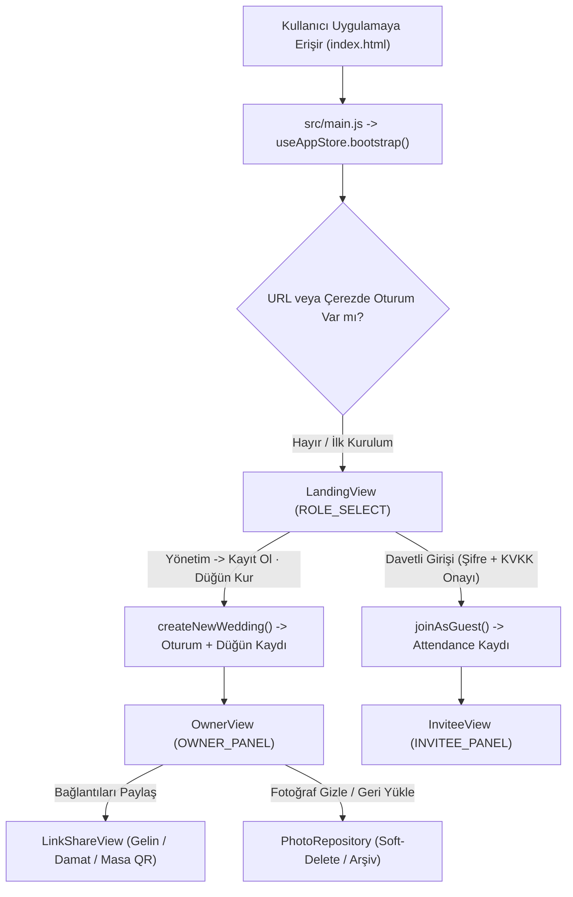

# FotoYönetim — Mimari Atlas ve Kod Tabanı Haritası (`CODEBASE_MAP.md`)

**FotoYönetim**, düğün ve özel davet organizasyonlarında çekilen fotoğrafların gerçek zamanlı olarak toplanmasını, sahiplik ve referans kaynaklarına göre izlenmesini ve telif/gizlilik protokollerine uygun biçimde yönetilmesini sağlayan uçtan uca bir SaaS platformudur. Bu doküman, projeye yeni katılan bir yazılım mühendisinin, sistem mimarının veya ürün yöneticisinin kod tabanındaki her bir dosyanın varlık nedenini, katmanlar arasındaki veri akışını ve tasarım kararlarını tek bir bakışta kavrayabilmesi amacıyla hazırlanmıştır.

Mimari kurgu, **"gereksiz karmaşıklığı optimize etmek yerine tamamen ortadan kaldırmak"** ilkesi üzerine inşa edilmiştir. Arka uçta CGO bağımlılığı bulunmayan saf **Go (Echo v4 + modernc/sqlite)** ve önceden derlenmiş (pre-compiled) **Repository Pattern** katmanı görev yaparken; ön uçta herhangi bir derleme (bundler/transpiler) adımı gerektirmeyen, doğrudan tarayıcıda yerel ES modülleri (`src/`) olarak çalışan **React + Zustand** tabanlı reaktif bir mimari yer alır.

---

## 1. Dizin ve Dosya Topolojisi

Aşağıdaki ağaç yapısı, projenin kök dizininden itibaren tüm fonksiyonel birimlerinin yerleşimini göstermektedir:

```text
fotoyonetim/
├── main.go                       # Uygulamanın ana giriş noktası (HTTP sunucu, yönlendirme, DI kurulumu)
├── main_test.go                  # Sunucu rotaları, sağlık kontrolü ve sıfırdan kurulum entegrasyon testleri
├── go.mod / go.sum               # Go modül tanımları ve kriptografik paket özetleri
├── index.html                    # Tek Sayfa Uygulaması (SPA) kabuğu ve ES modül yükleyicisi
├── app.js                        # Geriye dönük uyumluluk sağlayan modüler yönlendirici (src/main.js'e işaret eder)
├── style.css                     # Editoryal tasarım sistemi (Cormorant Garamond, Caveat, Sıfır Emoji)
│
├── db/                           # Veritabanı Altyapı ve Erişim Katmanı
│   ├── migrate.go                # İdempotent DDL şema kurulumu ve güvenli ALTER TABLE migrasyonları
│   └── repo/                     # Repository Pattern (Önceden derlenmiş SQL sorguları)
│       ├── types.go              # Domain modelleri ve Repository arayüz (interface) sözleşmeleri
│       ├── wedding.go            # Düğün oluşturma, esnek kod/isim arama ve şifre güncelleme sorguları
│       ├── photo.go              # Fotoğraf kayıt, aktif galeri, arşiv (soft-delete) ve geri yükleme sorguları
│       ├── guest.go              # Davetli katılım ve referans (gelin/damat/masa-qr) sorguları
│       ├── photographer.go       # Organizasyon/fotoğrafçı hesap yönetimi sorguları
│       ├── analytics.go          # Asenkron etkinlik ve trafik izleme sorguları
│       └── repo_test.go          # Tüm SQL sorgularını ve sahiplik protokollerini doğrulayan birim testler
│
├── handlers/                     # HTTP Denetleyici (Controller) ve İş Mantığı Katmanı
│   ├── handlers.go               # REST API uç noktaları, Magic-Byte doğrulaması ve yetkilendirme katmanı
│   └── handlers_test.go          # API uç noktalarının uçtan uca senaryo ve güvenlik testleri
│
├── storage/                      # Fiziksel Disk ve Medya Yönetimi Katmanı
│   ├── storage.go                # Fotoğrafların fiziksel klasörlerde saklanması ve manifest.json indekslemesi
│   ├── storage_test.go           # Disk yazma ve yumuşak silme (soft-delete) koruma testleri
│   └── manifest.json             # Fotoğraf-düğün-yükleyen eşleşmelerini tutan kalıcı üstveri kütüğü
│
├── src/                          # İstemci Tarafı (Frontend) Modüler React + Zustand Mimarisi
│   ├── main.js                   # İstemci başlatıcısı (Senkron bootstrap ve kök DOM bağlama)
│   ├── react.js                  # Sıfır bağımlılıklı (Offline-First) Virtual DOM + Hooks çalışma zamanı
│   ├── store/
│   │   └── index.js              # Zustand durum mağazası (Oturum, FSM ekran geçişleri, galeri ve filtreler)
│   ├── services/
│   │   ├── security.js           # Kriptografik oturum kasası (Cookie + LocalStorage), rumuz ve slug üretici
│   │   └── repositories.js       # İstemci tarafı veri erişim katmanı (Wedding, Photo, Attendance)
│   └── components/
│       ├── App.js                # Kök bileşen, ekran yönlendiricisi (Router) ve bildirim (Toast) yöneticisi
│       ├── LandingView.js        # Bölünmüş karşılama ekranı (Davetli Girişi, Yönetici Girişi ve Sıfırdan Kurulum)
│       ├── OwnerView.js          # Yönetim paneli (Şifre yönetimi, aktif/arşiv fotoğraf kontrolü, davetli takibi)
│       ├── InviteeView.js        # Davetli paneli (50 fotoğraf limitli yükleme alanı ve canlı düğün galerisi)
│       ├── LinkShareView.js      # Özel davet bağlantıları (Gelin, Damat, Masa QR, Yönetici) üretim ve paylaşım ekranı
│       └── Modals.js             # Yönetici şifre doğrulama ve KVKK / 5651 Yasal Sorumluluk pencereleri
│
└── Dokümantasyon ve Mimari Spesifikasyonlar
    ├── CODEBASE_MAP.md           # Kod tabanı haritası ve mimari rehber (bu doküman)
    ├── db_schema.md              # Veritabanı tabloları, indeksler ve normalizasyon kararları
    ├── epics.md                  # Kullanıcı hikayeleri, kabul kriterleri ve alternatif akış senaryoları
    ├── management.md             # Zustand durum yönetimi ve SaaS güvenlik mimarisi raporu
    ├── protocols.md              # KVKK, 5651 Yer Sağlayıcı, Soft-Delete ve Magic-Byte protokolleri
    ├── screens.md                # Sonlu Durum Makinesi (FSM) ekran geçiş diyagramları
    └── plan.md                   # Ürün vizyonu ve faz bazlı yol haritası
```

---

## 2. Arka Uç (Backend) Mimarisi: Go, Echo ve Repository Pattern

Arka uç mimarisi, bulut ortamlarında (`go run .` veya tekil binary olarak) saniyeler içinde ayağa kalkacak ve yüksek eşzamanlı fotoğraf yükleme trafiğini darboğaz olmadan karşılayacak şekilde tasarlanmıştır. Sistem üç temel katmandan oluşur: **Sunucu ve Yönlendirme (`main.go`)**, **İş Mantığı ve Denetleyiciler (`handlers/`)** ve **Veri Erişim Katmanı (`db/` ve `storage/`)**.

### 2.1. Sunucu Başlatma ve Bağımlılık Enjeksiyonu ([main.go](file:///c:/Users/Huawei/Desktop/fotoyonetim/main.go))
Uygulama başlatıldığında [main.go](file:///c:/Users/Huawei/Desktop/fotoyonetim/main.go) ilk olarak `uploads/`, `thumbs/` ve `storage/` fiziksel dizinlerinin varlığını garanti altına alır. Ardından SQLite veritabanı bağlantısını **WAL (Write-Ahead Logging)** modunda ve yabancı anahtar kısıtlamaları (`_foreign_keys=on`) aktif olarak açar. WAL modu, aynı anda yüzlerce davetli galeriyi okurken fotoğraf yükleme (yazma) işlemlerinin birbirini kilitlememesini sağlar.

[`BuildApp`](file:///c:/Users/Huawei/Desktop/fotoyonetim/main.go#L31-L133) fonksiyonu tüm repository nesnelerini oluşturur ve bu sırada uygulama içindeki **tüm SQL cümlelerini önceden derler (`db.Prepare`)**. Eğer herhangi bir SQL sorgusunda sözdizimi veya şema hatası varsa, uygulama çalışma zamanında (runtime) değil, henüz başlatılma aşamasında hatayı yakalar. Ayrıca [`resolveWebRoot`](file:///c:/Users/Huawei/Desktop/fotoyonetim/main.go#L20-L29) yardımcı fonksiyonu sayesinde sunucu hem proje kök dizininden hem de `server/` alt dizininden çalıştırıldığında `index.html`, `style.css`, `/src` modülleri ve `/assets` dosyalarını kesintisiz sunar.

### 2.2. Veritabanı Şeması ve Migrasyon Katmanı ([db/migrate.go](file:///c:/Users/Huawei/Desktop/fotoyonetim/db/migrate.go))
Veritabanı katmanı tamamen idempotent bir yapıya sahiptir. [`Migrate`](file:///c:/Users/Huawei/Desktop/fotoyonetim/db/migrate.go#L11-L202) fonksiyonu her çalıştığında temel tabloları (`photographers`, `weddings`, `guests`, `photos`, `photo_tags`, `persons`, `face_embeddings`, `notifications`, `analytics_events`, `consent_records`) oluşturur. Bununla birlikte, sıfırdan fotoğrafçı hesabı açmadan doğrudan yönetici kaydıyla kurulan düğünlerin yabancı anahtar (`FOREIGN KEY`) bütünlüğünü korumak adına sistemde varsayılan bir `default-photographer` kaydı tohumlanır (seed). Mevcut veritabanı dosyalarının yeni sürümlere geçişinde veri kaybı yaşanmaması için `owner_name`, `owner_role`, `owner_passcode`, `guest_passcode` ve `deleted_by` sütunları güvenli `ALTER TABLE` ifadeleriyle tabloya eklenir.

### 2.3. Sözleşmeli Veri Erişimi: `db/repo` Paketi
İş mantığının veritabanı motorundan tamamen soyutlanması için [db/repo/types.go](file:///c:/Users/Huawei/Desktop/fotoyonetim/db/repo/types.go) dosyasında beş ana arayüz (`PhotographerRepository`, `WeddingRepository`, `GuestRepository`, `PhotoRepository`, `AnalyticsRepository`) tanımlanmıştır:

- **Düğün Havuzu ([db/repo/wedding.go](file:///c:/Users/Huawei/Desktop/fotoyonetim/db/repo/wedding.go))**: Düğün kayıtlarını yönetir. Buradaki en kritik mühendislik detayı `stmtByCode` sorgusudur; kullanıcı giriş yaparken tam düğün kodunu (`ayse-mehmet-2026-ab12`), sadece kısa adını (`ayse-mehmet`) veya doğrudan çiftin adını (`Ayşe & Mehmet`) yazsa dahi büyük/küçük harf duyarsız olarak doğru düğünü bulup getirir. Ayrıca hem yönetici şifresini hem de davetli katılım şifresini güncelleyen [`UpdatePasscodes`](file:///c:/Users/Huawei/Desktop/fotoyonetim/db/repo/wedding.go#L179-L182) metodunu barındırır.
- **Fotoğraf Havuzu ([db/repo/photo.go](file:///c:/Users/Huawei/Desktop/fotoyonetim/db/repo/photo.go))**: Fotoğrafların yaşam döngüsünü yönetir. [`ListByWedding`](file:///c:/Users/Huawei/Desktop/fotoyonetim/db/repo/photo.go#L146-L153) yalnızca onaylanmış ve silinmemiş (`is_deleted = 0`) fotoğrafları genel galeriye sunarken, [`ListArchivedByWedding`](file:///c:/Users/Huawei/Desktop/fotoyonetim/db/repo/photo.go#L188-L195) yöneticiler tarafından yayından kaldırılmış (`is_deleted = 1`) fotoğrafları arşiv sekmesi için listeler. [`SoftDelete`](file:///c:/Users/Huawei/Desktop/fotoyonetim/db/repo/photo.go#L164-L174) ve [`Restore`](file:///c:/Users/Huawei/Desktop/fotoyonetim/db/repo/photo.go#L176-L186) metodları, alt sorgu (`WHERE wedding_id IN (SELECT id FROM weddings WHERE photographer_id = ?)`) kullanarak bir yöneticinin yalnızca kendi düğününe ait fotoğraflar üzerinde işlem yapabilmesini SQL seviyesinde garanti eder.
- **Davetli ve Analitik Havuzları ([db/repo/guest.go](file:///c:/Users/Huawei/Desktop/fotoyonetim/db/repo/guest.go), [db/repo/analytics.go](file:///c:/Users/Huawei/Desktop/fotoyonetim/db/repo/analytics.go))**: Davetlinin hangi referans bağlantısıyla (`gelin`, `damat`, `masa-qr`) geldiğini, KVKK onay durumunu ve anonimleştirilmiş (`SHA-256` ile özetlenmiş) IP/tarayıcı izlerini kaydeder.

### 2.4. Denetleyiciler ve Güvenlik Duvarı ([handlers/handlers.go](file:///c:/Users/Huawei/Desktop/fotoyonetim/handlers/handlers.go))
HTTP isteklerini karşılayan [handlers/handlers.go](file:///c:/Users/Huawei/Desktop/fotoyonetim/handlers/handlers.go), istemciden gelen hiçbir veriye körü körüne güvenmez. Özellikle [`UploadPhoto`](file:///c:/Users/Huawei/Desktop/fotoyonetim/handlers/handlers.go#L353-L465) fonksiyonu iki katmanlı koruma uygular:
1. **Toplu Yükleme Sınırı (UC-18)**: Tek bir istekte en fazla 50 fotoğraf kabul edilir; fazlası anında `400 Bad Request` ile reddedilir.
2. **Magic-Byte (Dosya İmzası) Doğrulaması**: Yüklenen dosyanın uzantısına veya `Content-Type` başlığına bakılmaz; dosyanın ilk 12 baytı okunarak [`isImageMagic`](file:///c:/Users/Huawei/Desktop/fotoyonetim/handlers/handlers.go#L606-L622) fonksiyonundan geçirilir. Yalnızca gerçek JPEG (`FF D8 FF`), PNG (`89 50 4E 47`), GIF, WEBP veya TIFF ikili imzasına sahip dosyalar diske yazılır.

Ayrıca sıfırdan kurulum için [`SetupWedding`](file:///c:/Users/Huawei/Desktop/fotoyonetim/handlers/handlers.go#L179-L238) (`POST /api/v1/weddings/setup`), yönetici girişi için [`LoginWeddingManager`](file:///c:/Users/Huawei/Desktop/fotoyonetim/handlers/handlers.go#L242-L289) (`POST /api/v1/weddings/:code/login`) ve şifre güncellemeleri için [`UpdateWeddingPasscodes`](file:///c:/Users/Huawei/Desktop/fotoyonetim/handlers/handlers.go#L293-L326) (`PUT /api/v1/weddings/:code/passcode`) uç noktaları bu katmanda yer alır.

### 2.5. Fiziksel Depolama ve Yumuşak Silme Koruması ([storage/storage.go](file:///c:/Users/Huawei/Desktop/fotoyonetim/storage/storage.go))
Fotoğraflar veritabanında BLOB olarak tutulmaz; `uploads/{wedding_id}/` ve `thumbs/{wedding_id}/` dizinlerine fiziksel dosya olarak yazılır. [storage/storage.go](file:///c:/Users/Huawei/Desktop/fotoyonetim/storage/storage.go) içindeki [`DiskStorage`](file:///c:/Users/Huawei/Desktop/fotoyonetim/storage/storage.go#L25-L30) yapısı, her fotoğrafın hangi düğüne ve hangi yükleyiciye ait olduğunu `storage/manifest.json` dosyasında indeksler. Yöneticiler bir fotoğrafı sildiğinde, dosya fiziksel diskten **asla silinmez** (`os.Remove` çağrılmaz); yalnızca görünürlük bayrağı (`is_deleted: true`) güncellenir. Böylece yanlışlıkla gizlenen veya ileride ihtiyaç duyulan her fotoğraf arşivden tek tıkla geri döndürülebilir.

---

## 3. Ön Uç (Frontend) Mimarisi: Modüler React, Zustand ve Editoryal Tasarım

Ön uç katmanı, önceki monolitik yapının tamamen parçalanarak tek sorumluluk ilkesine (Single Responsibility Principle) göre yeniden yazıldığı `src/` dizininde yaşar.

### 3.1. Sıfır Bağımlılıklı Çalışma Zamanı ([src/react.js](file:///c:/Users/Huawei/Desktop/fotoyonetim/src/react.js) ve [src/main.js](file:///c:/Users/Huawei/Desktop/fotoyonetim/src/main.js))
Tarayıcı ortamında harici CDN bağlantı제 (`unpkg.com`) engellense veya internet bağlantısı kesilse bile uygulamanın Splash ekranında donmaması için [src/react.js](file:///c:/Users/Huawei/Desktop/fotoyonetim/src/react.js) içinde yerleşik bir **Virtual DOM ve Hooks (`h`, `useState`, `useEffect`, `useRef`, `createRoot`) motoru** bulunur. Tarayıcıda global `window.React` mevcutsa onu kullanır, aksi halde otomatik olarak yerleşik motora geçer. [src/main.js](file:///c:/Users/Huawei/Desktop/fotoyonetim/src/main.js) ise ilk DOM çizimi yapılmadan hemen önce `useAppStore.getState().bootstrap()` metodunu senkron olarak çağırarak kullanıcının bekleme ekranında takılmasını engeller.

### 3.2. Merkezi Durum Yönetimi ve FSM ([src/store/index.js](file:///c:/Users/Huawei/Desktop/fotoyonetim/src/store/index.js))
Uygulamanın tüm durumu ve ekranlar arası geçişleri (Sonlu Durum Makinesi / FSM) [src/store/index.js](file:///c:/Users/Huawei/Desktop/fotoyonetim/src/store/index.js) içerisindeki [`useAppStore`](file:///c:/Users/Huawei/Desktop/fotoyonetim/src/store/index.js#L25-L499) üzerinde toplanmıştır:

- **`bootstrap()`**: URL'deki arama parametrelerini (`?dugun=...`, `?ref=gelin`) ve hash rotalarını (`#/ayse-mehmet/yonetim`) ayrıştırır. Kullanıcının çerezdeki oturumu doğrulanmış bir yöneticiye aitse doğrudan `OWNER_PANEL` ekranını açar; aksi halde `ROLE_SELECT` (Karşılama) ekranına yönlendirir.
- **`createNewWedding()`**: Uygulama sıfırdan kurulduğunda yöneticinin adını, rolünü (*Düğün Sahibi*, *Fotoğrafçı*, *Sağdıç*), düğün adını ve belirlediği yönetici/davetli şifrelerini kaydeder. Aynı anda yönetici oturumunu (`SecurityVault.setSession`) başlatarak kullanıcıyı doğrudan kendi adı ve rolüyle **Yönetim Paneli (`OWNER_PANEL`)** ekranına taşır ve arka planda Go API'si (`/api/v1/weddings/setup`) ile senkronize olur.
- **`loginAsManager()` & `joinAsGuest()`**: Mevcut bir düğüne yönetici veya davetli olarak giriş yapılmasını sağlar. Yöneticiler giriş yaparken isim alanını boş bıraksa dahi düğünün kayıtlı yönetici adı (`ownerName`) otomatik olarak yüklenir.
- **`cancelInvitation()`**: Davetlinin yanlış veya eski bir özel davet bağlantısıyla gelmesi durumunda tek tıkla aktif bağlantıyı sıfırlayıp URL geçmişini temizlemesini ve düğün kodunu manuel girebilmesini sağlar.
- **`softDeleteSelectedPhotos()` & `restoreSelectedPhotos()`**: Seçilen fotoğrafların genel galeriden gizlenmesini (arşive kaldırılmasını) ve istendiğinde arşivden tekrar yayına alınmasını yönetir.

### 3.3. Güvenlik Kasası ve İstemci Havuzları (`src/services/`)
- **[src/services/security.js](file:///c:/Users/Huawei/Desktop/fotoyonetim/src/services/security.js)**: [`SecurityVault`](file:///c:/Users/Huawei/Desktop/fotoyonetim/src/services/security.js#L6-L81) nesnesi, kullanıcının kimlik ve rol bilgisini (`guest`, `owner`, `bestman`, `photographer`) tıpkı bir Google hesabı oturumu gibi 365 gün boyunca `SameSite=Lax` çerezlerinde ve yerel depolamada kalıcı olarak saklar. Ayrıca Türkçe karakter uyumlu kullanıcı rumuzu (`ahmet_yilmaz_48`) ve URL dostu düğün kodu (`slugify`) üretimini üstlenir.
- **[src/services/repositories.js](file:///c:/Users/Huawei/Desktop/fotoyonetim/src/services/repositories.js)**: İstemci bileşenlerinin ham veri yapısına doğrudan dokunmasını engelleyen [`WeddingRepository`](file:///c:/Users/Huawei/Desktop/fotoyonetim/src/services/repositories.js#L131-L209), [`PhotoRepository`](file:///c:/Users/Huawei/Desktop/fotoyonetim/src/services/repositories.js#L212-L280) ve [`AttendanceRepository`](file:///c:/Users/Huawei/Desktop/fotoyonetim/src/services/repositories.js#L283-L338) katmanlarını içerir.

### 3.4. Görünüm Bileşenleri (`src/components/`) ve Tasarım Dili ([style.css](file:///c:/Users/Huawei/Desktop/fotoyonetim/style.css))
Arayüz bileşenleri, **Cormorant Garamond** (editoryal serif), **Caveat** (el yazısı imza dokunuşu), ince çizgiler (`0.5px solid`) ve yalnızca vurgu amaçlı kullanılan altın tonu (`--gold: #c9a96e`) üzerine kurulu, **sıfır emoji** prensibine sadık bir estetik taşır:

1. **[LandingView.js](file:///c:/Users/Huawei/Desktop/fotoyonetim/src/components/LandingView.js)**: Sol tarafta düğün atmosferini yansıtan tam boy görsel ve alıntı, sağ tarafta ise yalnızca iki ana sekmeden (**`Davetli Girişi`** ve **`Yönetim`**) oluşan yalın bir giriş kartı sunar. `Yönetim` sekmesi altında mevcut düğünler için **`Giriş Yap`** ve sıfırdan kurulumlar için **`Kayıt Ol · Düğün Kur`** modları yer alır.
2. **[OwnerView.js](file:///c:/Users/Huawei/Desktop/fotoyonetim/src/components/OwnerView.js)**: Düğün sahibi, sağdıç veya fotoğrafçı için tasarlanmış komuta merkezidir. Üst bölümde zarif bir altın çizgiyle ayrılan el yazısı yönetici imzası (`.manager-line`), hemen altında şifreleri görme ve değiştirme olanağı tanıyan **Erişim & Şifre Güvenliği** kartı (`.security-passcode-card`) bulunur. Fotoğraflar sekmesinde **`Yayındakiler`** ve **`Gizlenenler / Arşiv`** görünümleri arasında geçiş yapılabilir; Gelen Kişiler sekmesinde ise kalabalık istatistik kutuları yerine zarif bir **`ⓘ katılım dağılımı`** açılır penceresi ve referans filtreleri (`Gelin`, `Damat`, `Masa QR`) yer alır.
3. **[InviteeView.js](file:///c:/Users/Huawei/Desktop/fotoyonetim/src/components/InviteeView.js)**: Davetlinin kendi rumuzuyla (`merhaba, @kullanici`) karşılandığı, tek seferde 50 fotoğrafa kadar yükleme yapabildiği ve düğün galerisini canlı izlediği ekrandır.
4. **[LinkShareView.js](file:///c:/Users/Huawei/Desktop/fotoyonetim/src/components/LinkShareView.js)**: Düğüne özel üretilen 4 farklı takip bağlantısını (*Düğün Sahibi Yönetim*, *Gelin Tarafı*, *Damat Tarafı*, *Masa QR*) ve şifre bilgilerini tek tıkla kopyalanabilir kartlar halinde sunar.
5. **[Modals.js](file:///c:/Users/Huawei/Desktop/fotoyonetim/src/components/Modals.js)**: Doğrudan yönetim bağlantısıyla gelen kullanıcılar için şifre doğrulama penceresini ([`AuthModal`](file:///c:/Users/Huawei/Desktop/fotoyonetim/src/components/Modals.js#L4-L55)) ve hukuki koruma sağlayan **6698 Sayılı KVKK Aydınlatma Metni** ile **5651 Sayılı Yer Sağlayıcı / Kullanıcı Sorumluluk Beyanı** pencerelerini ([`LegalModal`](file:///c:/Users/Huawei/Desktop/fotoyonetim/src/components/Modals.js#L57-L95)) barındırır.

---

## 4. Uçtan Uca Veri Akışı ve Yaşam Döngüsü

Sistemin çalışma zamanındaki davranışını anlamak için üç temel akış izlenebilir:



---

## 5. Test ve Doğrulama Altyapısı

Kod tabanındaki her katman, regresyonları önlemek amacıyla otomatikleştirilmiş testlerle güvence altına alınmıştır:

- **[main_test.go](file:///c:/Users/Huawei/Desktop/fotoyonetim/main_test.go)**: `/health` kontrolünü, `/` ana sayfasını, `/src/main.js` modül sunumunu, `/api/v1/weddings/setup` ile sıfırdan düğün kurulumunu, yönetici girişini ve SPA rota yakalamasını (`/:code`) test eder.
- **[db/repo/repo_test.go](file:///c:/Users/Huawei/Desktop/fotoyonetim/db/repo/repo_test.go)**: Bellek içi (`:memory:`) SQLite üzerinde tüm hazırlanan SQL sorgularını, slug ön ekiyle düğün bulmayı, şifre değiştirmeyi, yetkisiz fotoğraf silme engellerini ve arşivden geri yükleme (`Restore`) akışını doğrular.
- **[handlers/handlers_test.go](file:///c:/Users/Huawei/Desktop/fotoyonetim/handlers/handlers_test.go)**: Fotoğrafçı kaydından 50 fotoğraf limitine, sahte dosya (Magic-Byte) reddinden toplu indirmeye kadar tüm HTTP API senaryolarını simüle eder.
- **[storage/storage_test.go](file:///c:/Users/Huawei/Desktop/fotoyonetim/storage/storage_test.go)**: Fiziksel disk klasörlerinin oluşturulmasını ve yumuşak silme işleminde dosyaların diskten silinmediğini doğrular.

Tüm test süitini tek komutla çalıştırmak için proje kök dizininde şu komut kullanılır:

```powershell
go test -count=1 -v ./...
```

